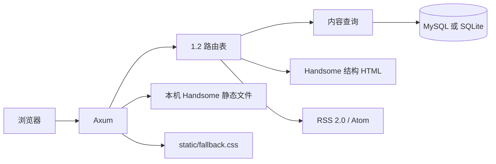

# 架构

Tiebidli 是一个只读公开站（评论写入除外）。每次请求都从 Typecho 1.2 的表里读配置，不在进程里迁移 schema。

## 模块

| 模块 | 职责 |
| --- | --- |
| `phpval` | 解析 `routingTable`、`theme:handsome` 的 PHP `serialize` 子集 |
| `router` | 移植 `var/Typecho/Router/Parser.php` 的占位符 |
| `repo` | 按 1.2 列名查询。MySQL 用反引号，SQLite 用双引号 |
| `text` | `<!--markdown-->`、`<!--more-->`、PHP 日期格式、站点时区 |
| `render` | MiniJinja 模板，class 与 Handsome 公开页一致。主题脚本要求 `THEME_POST_CONTENT` 为 `"2"`、`SHOW_FOOTER` 为 `"1"`，否则会把整页换成「页面缓存失败」。`PLUGIN_READY` 设为 `"1"`，避免没有后台插件时弹出安装提示 |
| `http` | 按路由表顺序尝试。某条规则找不到内容时继续下一条 |
| `feed` | 文章列表或评论的 RSS 2.0 / Atom |

`created` 按真实 Unix 时间保存。展示和按日归档都使用 `options.timezone` 的固定偏移。Typecho 还会再减一次 `serverTimezone`；那个值不在数据库里，这里用站点偏移作为墙钟。

## 请求

1. 去掉 `/index.php` 前缀和末尾斜杠，按路径段做百分号解码。
2. `GET` 且带有非空 `s` 时，跳到搜索路由。
3. 用当前 `routingTable` 覆盖后的规则依次匹配。
4. 文章、页面、分类、标签、作者、日期、搜索、订阅各自查询。
5. 都未命中时，再试 `/archives/{slug}` 与 `/archives/{slug}.html`。
6. 最后返回 404 模板。

评论 `POST` 打到反馈路由，例如 `/archives/1/comment`。校验顺序贴近 `Widget/Feedback.php`：必填、邮箱、网址、父评论、Referer、同一文章同一 IP 的发言间隔。停用词和 IP 黑名单写成 `spam`。蜜罐字段 `tiebidli_hp` 有内容时直接丢弃。

密码表单字段是 `protectPassword` 和 `protectCID`。cookie 名是 `protectPassword_{cid}`，没有 Typecho 的 md5 前缀。

## 测试

`cargo test` 用官方 SQLite 安装脚本建一个临时库，覆盖首页分页、cid 与缩略名、分类、标签、搜索、RSS/Atom、评论、密码、404、自定义永久链接、静态首页和 `/blog/`。
