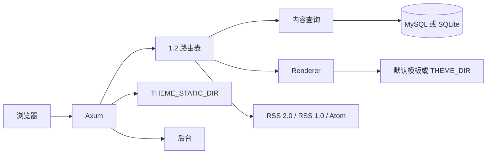

# 架构

Tiebidli 读取 Typecho 1.2 的表，提供公开站、评论/引用写入、XML-RPC 和最小后台。不在进程里迁移 schema。

## 模块

| 模块 | 职责 |
| --- | --- |
| `phpval` | 解析 `routingTable`、`theme:{name}` 的 PHP `serialize` 子集，并写出附件字段 |
| `router` | 移植 `var/Typecho/Router` 的占位符 |
| `repo` / `write` | 按 1.2 列名读写。MySQL 用反引号，SQLite 用双引号 |
| `text` | `<!--markdown-->`、`<!--more-->`、PHP 日期格式、站点时区 |
| `theme` | `Renderer` 接口。HTTP 只调用它 |
| `render` | 默认 MiniJinja 模板，实现 `Renderer` |
| `http` | 按路由表顺序尝试。某条规则找不到内容时继续下一条 |
| `feed` | RSS 2.0、RSS 1.0 RDF、Atom |
| `auth` | phpass、`$T$`、md5，以及 `md5(rootUrl)` cookie 前缀 |
| `comments` | 评论分页与引用列表 |
| `xmlrpc` | `/action/xmlrpc` |
| `admin` | `/admin` 最小后台 |

`created` 按真实 Unix 时间保存。展示和按日归档都使用 `options.timezone` 的固定偏移。Typecho 还会再减一次 `serverTimezone`；那个值不在数据库里，这里用站点偏移作为墙钟。

## 请求

1. 去掉 `/index.php` 前缀和末尾斜杠，按路径段做百分号解码。
2. `/action/xmlrpc` 单独处理，不把正文当成表单。
3. `GET` 且带有非空 `s` 时，跳到搜索路由。
4. 用当前 `routingTable` 覆盖后的规则依次匹配。
5. 文章、页面、附件、分类、标签、作者、日期、搜索、订阅、评论分页各自查询。
6. 都未命中时，再试 `/archives/{slug}` 与 `/archives/{slug}.html`。
7. 最后返回 404 模板。

匿名可见性和 1.2 一致：列表只要 `publish` 且 `created` 早于现在。直链还接受 `hidden`。`private`、`draft`、`waiting` 以及未来时间的文章不公开。

评论 `POST` 打到反馈路由，例如 `/archives/1/comment`。校验顺序贴近 `Widget/Feedback.php`。停用词和 IP 黑名单写成 `spam`。蜜罐字段 `tiebidli_hp` 有内容时直接丢弃。`/archives/1/trackback` 接收引用：必须是 POST 且没有 Referer，成功时返回 `success=0` 的 XML。Pingback 走 XML-RPC `pingback.ping`，只拉取 `http://` 源站。

密码表单字段是 `protectPassword` 和 `protectCID`。cookie 名是 `md5(rootUrl)` 直接接上 `protectPassword_{cid}`，`rootUrl` 不带末尾斜杠。评论记住用户名的 cookie 用同一前缀。

`commentsPageBreak` 打开时，评论分页只切顶层评论，子评论跟在当前页的父评论下面。地址来自 `comment_page` 路由。

附件页读 `contents.type=attachment`。`text` 是 PHP 序列化的 name/path/size/type/mime。图片扩展名输出 ``，其他输出链接。`?download=1` 从 `UPLOADS_DIR` 把文件发回去。

`allowXmlRpc` 缺省按安装值 2。0 关闭端点，1 去掉 pingback，2 包含 pingback。`GET ?rsd` 与 `?wlw` 返回说明。已实现 `system.listMethods`，以及 metaWeblog / WordPress / MovableType / Blogger 里读写文章、页面、分类、标签和上传媒体的常用方法。密码对照用户表：`$P$`、`$T$` 或 md5。

## 主题

`Renderer` 接收页面上下文（站点 options、当前文章、列表、分页、侧栏、评论树），返回 HTML。默认实现是内置 MiniJinja 模板。

- `THEME_DIR`：启动时用同名 html 覆盖 `base.html`、`list.html`、`single.html`、`search.html`、`404.html`。以后可以在这个接口后面换别的模板引擎，HTTP 层不用改。
- `THEME_STATIC_DIR`：主题静态文件，挂到 `/usr/themes/{theme}/`。`options.theme` 是目录名，缺省 `default`。主题自己的设置读 `theme:{name}`。
- 目录里有 `assets/css/style.css` 时，默认模板改用它；否则用 `/static/fallback.css`。
- 插件钩子本轮没有实现。以后可以在 `Renderer` 前后加扩展点，不放进这次的请求路径。

## 后台

`/admin` 按 Typecho 1.2.1 的 `admin/header.php`、`menu.php`、`footer.php` 和各 `manage-*` / `write-*` / `options-*` 页面来排：顶栏分组、列表表格、撰写表单和设置分组。样式直接使用 1.2 的 `admin/css` 与 `admin/img`（见 `static/admin`）。注册只在 `allowRegister` 为真时打开。1.2 默认不提供找回密码，这里也不做。

权限沿用 1.2 的等级：administrator、editor、contributor、subscriber。数字越小权限越大。贡献者只能改自己的文章，发布会变成 `waiting`。编辑可以管别人的内容、评论和分类。管理员才能改用户和设置。

## 测试

`cargo test` 用官方 SQLite 安装脚本建临时库。覆盖公开路由、RSS/Atom/RSS 1.0、评论分页、密码 cookie 前缀、附件下载、trackback、pingback、XML-RPC 发文、后台登录后改文章。

## 还没做

- 主题安装市场、插件安装与钩子
- 备份导入导出、安装向导、版本升级迁移
- 某套主题自带的短代码、PJAX、播放器、AMP
- `frontPage=file:` 指定的主题文件
- 反垃圾 JS token
- 热门文章按 `commentsNum`，因为 1.2 核心没有 `views`
- 日期归档用站点时区的 `[开始, 次日)`，和 Typecho 含当天 23:59:59 的写法差一秒
