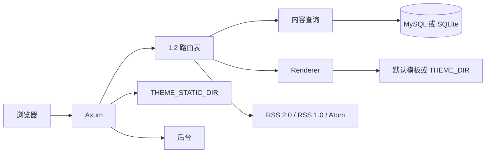

# 架构

Tiebidli 读取 Typecho 1.2 的表，提供公开站、评论/引用写入、XML-RPC 和最小后台。不在进程里迁移 schema。

## 模块

| 模块 | 职责 |
| --- | --- |
| `phpval` | 解析 `routingTable`、`theme:{name}` 的 PHP `serialize` 子集，并写出附件字段 |
| `router` | 移植 `var/Typecho/Router` 的占位符 |
| `repo` / `write` | 按 1.2 列名读写。MySQL 用反引号，SQLite 用双引号 |
| `text` | `<!--markdown-->`、`<!--more-->`、PHP 日期格式、站点时区 |
| `theme` | `Renderer` 接口。HTTP 只调用它 |
| `render` | 默认 MiniJinja 模板，实现 `Renderer` |
| `http` | 按路由表顺序尝试。某条规则找不到内容时继续下一条 |
| `feed` | RSS 2.0、RSS 1.0 RDF、Atom |
| `auth` | phpass、`$T$`、md5，以及 `md5(rootUrl)` cookie 前缀 |
| `comments` | 评论分页与引用列表 |
| `xmlrpc` | `/action/xmlrpc` |
| `admin` | `/admin` 后台页面和 `/action/` |
| `themes` | 外观目录、启用和默认外观设置 |
| `backup` | Typecho 1.2 备份缓冲的导出和恢复 |
| `plugins` | 进程内功能登记表。HelloWorld 只挂后台顶栏 |

`created` 按真实 Unix 时间保存。展示和按日归档都使用 `options.timezone` 的固定偏移。Typecho 还会再减一次 `serverTimezone`；那个值不在数据库里，这里用站点偏移作为墙钟。

## 请求

1. 保留原始路径（含 `/index.php` 和末尾斜杠）用来对照永久链接。匹配前再去掉 `/index.php` 前缀和末尾斜杠，并按路径段做百分号解码。两种入口都进同一套规则。
2. `options.rewrite` 决定生成链接是否带 `/index.php`，对应 `Options->index` 和 `Common::url`。`rewrite=0` 时前缀是 `/index.php`。
3. 命中文章、页面、分类、标签、作者、日期、搜索、订阅后，若请求路径和永久链接不一致则 301。首页、评论分页、评论提交、动作和 404 不跳。缩略名兜底命中后也 301 到当前永久链接。
4. `/action/xmlrpc` 单独处理，不把正文当成表单。地址同样跟随 `rewrite`。
5. 带有非空 `s` 时 302 到搜索路由，目标也带 `Options->index`。
6. 用当前 `routingTable` 覆盖后的规则依次匹配。占位符与 `Router\Parser` 相同。
7. 文章、页面、附件、分类、标签、作者、日期、搜索、订阅、评论分页各自查询。
8. 都未命中时，再试 `/archives/{slug}` 与 `/archives/{slug}.html`。
9. 最后返回 404 模板。

匿名可见性和 1.2 一致：列表只要 `publish` 且 `created` 早于现在。直链还接受 `hidden`。`private`、`draft`、`waiting` 以及未来时间的文章不公开。

评论 `POST` 打到反馈路由，例如 `/archives/1/comment`；`rewrite=0` 时地址是 `/index.php/archives/1/comment`。校验顺序贴近 `Widget/Feedback.php`。停用词和 IP 黑名单写成 `spam`。蜜罐字段 `tiebidli_hp` 有内容时直接丢弃。`/archives/1/trackback` 接收引用：必须是 POST 且没有 Referer，成功时返回 `success=0` 的 XML。Pingback 走 XML-RPC `pingback.ping`，只拉取 `http://` 源站。

密码表单字段是 `protectPassword` 和 `protectCID`。cookie 名是 `md5(rootUrl)` 直接接上 `protectPassword_{cid}`，`rootUrl` 不带末尾斜杠。评论记住用户名的 cookie 用同一前缀。

`commentsPageBreak` 打开时，评论分页只切顶层评论，子评论跟在当前页的父评论下面。地址来自 `comment_page` 路由。

附件页读 `contents.type=attachment`。`text` 是 PHP 序列化的 name/path/size/type/mime。图片扩展名输出 ``，其他输出链接。`?download=1` 从 `UPLOADS_DIR` 把文件发回去。

`allowXmlRpc` 缺省按安装值 2。0 关闭端点，1 去掉 pingback，2 包含 pingback。`GET ?rsd` 与 `?wlw` 返回说明。已实现 `system.listMethods`，以及 metaWeblog / WordPress / MovableType / Blogger 里读写文章、页面、分类、标签和上传媒体的常用方法。密码对照用户表：`$P$`、`$T$` 或 md5。

## 主题

`Renderer` 接收页面上下文（站点 options、当前文章、列表、分页、侧栏、评论树），返回 HTML。默认实现是内置 MiniJinja 模板。

- `THEME_DIR`：启动时用同名 html 覆盖 `base.html`、`list.html`、`single.html`、`search.html`、`404.html`。以后可以在这个接口后面换别的模板引擎，HTTP 层不用改。
- `THEME_STATIC_DIR`：主题静态文件，挂到 `/usr/themes/{theme}/`。`options.theme` 是目录名，缺省 `default`。主题自己的设置读 `theme:{name}`。
- 内置模板对齐 Typecho 1.2.1 默认主题 `usr/themes/default/` 的页头、列表、文章、归档、评论和侧栏。样式在 `static/themes/default/`（GPL-2.0，`normalize.css` 为 MIT）。目录里有 `assets/css/style.css` 时，默认模板改用那一套样式。
- 后台 `/admin/themes.php` 列出 `THEME_STATIC_DIR` 父目录下的外观。启用走 `/action/themes-edit?change=`，写入 `options.theme`，并删掉上一套外观的 `theme:{name}`。`frontPage` 以 `file:` 开头时改回 `recent`。
- 目录名 `default` 有内置设置页 `/admin/options-theme.php`：`logoUrl` 和 `sidebarBlock`（最新文章、最近回复、分类、归档、其它）。其它目录隐藏「设置外观」，打开 `/admin/options-theme.php` 回到外观列表并提示「该外观没有设置项」。`/admin/theme-editor.php` 读写 `THEME_DIR` 里已有的 `.html`，文件不可写时显示「此文件无法写入」。不编辑也不执行 PHP。
- 插件不是加载机制。`plugins` 模块是一份静态登记表：功能写在普通 Rust 模块里，和主程序编进同一个二进制。启用、停用只改 `options.plugins`，并决定已经写好的钩子会不会跑。这个选项的形状与 Typecho `Plugin::export()` 相同；插件设置在 `plugin:{Name}`。不加载 DLL，不 `dlopen` `.so`，不在运行时载入插件 crate，也不跑 WASM，也不扫描 `usr/plugins`。登记表里有 HelloWorld：启用后只在后台顶栏显示 `word`，默认 `Hello World`。配置页是 `/admin/options-plugin.php?config=HelloWorld`，动作是 `/action/plugins-edit`。公开模板仍预留 `plugin_header` / `plugin_footer`，不写插件名。HelloWorld 不登记公开页页脚。写入 `plugins` 的回调是 Typecho HelloWorld 的 `admin/menu.php:navBar`。没有 `personalConfig` 时，个人设置页不出现插件区块。

## 后台

后台路径与 Typecho 1.2.1 的 PHP 文件名一致：`/admin/index.php`、`/admin/login.php`、`/admin/write-post.php`、`/admin/manage-posts.php`、`/admin/category.php`、`/admin/media.php`、`/admin/options-permalink.php`、`/admin/plugins.php`、`/admin/themes.php`、`/admin/backup.php` 等。未登录访问后台会转到 `/admin/login.php?referer=`。旧的扁平路径（如 `/admin/posts/2`）301 到对应的 `.php` 地址。

页面按 `admin/header.php`、`menu.php`、`footer.php` 和各管理页来排：顶栏分组、列表表格、撰写表单和设置分组。样式直接使用 1.2 的 `admin/css` 与 `admin/img`（见 `static/admin`）。注册只在 `allowRegister` 为真时打开。1.2 默认不提供找回密码，这里也不做。

表单和批量操作提交到 `/action/...`，查询参数用 `do`，并校验 `_`。token 算法与 `Widget\Security::getToken` 相同：`md5(secret [& authCode & uid] & 当前页面 URL)`。登录、永久链接保存和备份固定走 `/index.php/action/...`，其余动作跟随 `rewrite`。

个人设置在 `/admin/profile.php`，顶栏用户名和「控制台」里的「个人设置」都指向它。档案、撰写选项和密码的校验文案与 `admin/profile.php` 一致。撰写选项写在 `typecho_options.user = 当前用户`。密码用 phpass，`PasswordHash(8, true)`。插件只有声明了个人配置字段时才出现在个人设置页。插件页没有插件市场，只列出进程内登记表。数据库里已启用、但这个程序没有的插件显示为文件已损坏，可以禁用。

评论列表可以行内编辑作者、邮箱、网址和内容，也可以以当前用户回复。回复写入 `typecho_comments`，`parent` 是被回复的 `coid`。

撰写页的「预览文章 / 预览页面」把当前表单交给 `/admin/preview`，用 `Renderer::render_single` 按公开站主题画出来，不写数据库。自定义字段按 `fieldNames[]` / `fieldTypes[]` / `fieldValues[]` 替换 `typecho_fields`。引用通告文本框按行解析 http(s) 地址；远程 ping 还不发。

分类列表对照 `manage-categories.php`：名称进入 `/admin/category.php?mid=`，表单提交到 `/action/metas-category-edit`。字段是分类名称、缩略名、父级和描述。合并把文章关系转到目标分类，子分类改挂到目标，然后删除源分类。删除分类时，子分类改挂到被删分类原来的父级。刷新按已发布文章重算 `count`。

文件列表对照 `manage-medias.php`，单文件页对照 `media.php`：标题、缩略名、描述，以及同扩展名替换。撰写页「附件」列出 `parent` 为当前文章的文件；新文章列出当前用户未归档的文件。上传后可以插入编辑器，保存时 `attachment[]` 会把这些文件挂到文章上。

权限沿用 1.2 的等级：administrator、editor、contributor、subscriber。数字越小权限越大。贡献者只能改自己的文章，发布会变成 `waiting`。编辑可以管别人的内容、评论和分类。管理员才能改用户和设置。

`/admin/backup.php` 对照 `Widget\Backup`。导出 contents、comments、metas、relationships、users、fields，不导出 options。每条记录是 `pack('vvV')`、JSON 字段长度、字段原文和 md5，整份文件以 `%TYPECHO_BACKUP_0001%` 开头和结尾。`FILE` 版本按 6 字节头读取。未知类型号跳过，这样带插件数据块的旧备份仍能恢复核心表。解析完整份文件后才写入；解析失败时不改现有数据。恢复到第一条管理员记录时重写登录 cookie。导出默认只下载。勾选「同时在服务器留一份」后，才在 `BACKUP_DIR`（默认 `./usr/backups`）留一份同名 `.dat`，页面可以下载或删除。下载和删除走 `/index.php/action/backup`，并校验 `_`。

## 测试

`cargo test` 用官方 SQLite 安装脚本建临时库。覆盖公开路由、`rewrite=0/1` 下每类路径的生成和 301、RSS/Atom/RSS 1.0、评论分页、密码 cookie 前缀、附件下载、trackback、pingback、XML-RPC、后台 `.php` 路径和 `/action/` 地址，个人设置校验、评论行内编辑和回复、未保存预览、自定义字段，以及分类编辑、合并、删除后子分类上移、文件编辑和撰写页附件挂靠，外观启用、默认外观的 LOGO 和侧栏，备份导出后从服务器和上传两条路径恢复，以及 HelloWorld 的启用、配置和禁用。永久链接预设的生成和匹配在 `router` 单元测试里。

## 预期做不到

| 能力 | 状态 | 说明位置 |
| --- | --- | --- |
| PHP 主题目录直接执行 | 不支持 | `src/theme.rs` 文件头 |
| 社区 PHP 插件目录直接运行 | 不支持 | `src/plugins.rs` 文件头 |
| 在线编辑并保存 PHP 外观文件 | 不支持。编辑器只保存 `THEME_DIR` 里已有的 `.html` | `src/themes.rs` |

## 还没做

- 主题安装市场。不扫描 `usr/plugins`，也不提供动态加载
- 撰写页引用通告的远程 HTTP ping
- 分类列表的拖拽排序
- 后台上传用的是普通文件框，不是 plupload
- 安装向导。`/admin/upgrade.php` 只说明手动替换二进制并重启，不执行数据库升级
- 某套主题自带的短代码、PJAX、播放器、AMP
- `frontPage=file:` 指定的主题文件
- 反垃圾 JS token
- 热门文章按 `commentsNum`，因为 1.2 核心没有 `views`
- 日期归档用站点时区的 `[开始, 次日)`，和 Typecho 含当天 23:59:59 的写法差一秒
